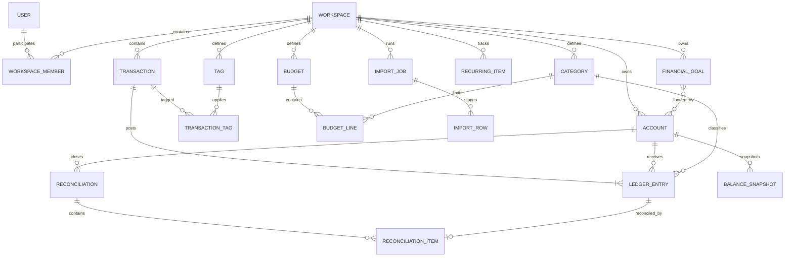

# Financial Services — Product and Architecture Blueprint

## 1. Product direction

Financial Services is a privacy-first personal-finance product that helps people maintain a trustworthy view of their money without requiring a bank connection. It begins as responsive, self-hostable web software and uses a modular monolith: Django and PostgreSQL provide the financial engine, Next.js provides the user interface, and background workers handle imports and recurring calculations.

The accounting core exposes familiar transactions to users but calculates balances from ledger entries. That separation prevents transfers, splits, refunds, credit-card payments, and liabilities from corrupting balances or reports.

Detailed signs, postings, lifecycle transitions, date rules, reconciliation behavior, rounding, metrics, and budget formulas are defined by the accepted [FINANCIAL_SEMANTICS.md](FINANCIAL_SEMANTICS.md).

The four core responsive workflows are specified for review in [PRODUCT_WIREFRAMES.md](PRODUCT_WIREFRAMES.md). They remain proposed until their status records product-owner acceptance.

### Product assumptions

- One user may own multiple financial workspaces or households.
- MVP uses Philippine peso (`PHP`) as the workspace base currency.
- Investments are tracked as account values in MVP; security-level holdings arrive in V2.
- CSV import is included in MVP; live bank synchronization waits until reconciliation and deduplication are proven reliable.
- The application is responsive web software packaged for self-hosting with Docker.
- The product tracks and explains finances; it does not move money or provide regulated financial advice.

### Goals

- Make account balances, net worth, and cash flow mathematically trustworthy.
- Give users a fast manual and CSV-based transaction workflow.
- Keep financial data private, portable, auditable, and recoverable.
- Support budgets, recurring obligations, liabilities, and savings goals on the same ledger foundation.
- Establish domain boundaries that allow bank feeds, investments, multi-currency reporting, and shared households to be added without rewriting the accounting core.

### MVP success criteria

The MVP is successful when a user can:

1. Create accounts and establish opening balances.
2. Import or manually enter transactions without duplication.
3. Categorize and split spending.
4. Reconcile calculated balances against statements.
5. See trustworthy net worth and monthly cash flow.
6. Create budgets and track rollover.
7. Record liabilities, subscriptions, and savings goals.
8. Export all of their data.

Correctness gates are equally important: transfers do not affect income or expense totals, split allocations balance, all workspace access is authorized, and a backup can be restored successfully.

## 2. Feature matrix

| Capability | MVP | V2 | V3 |
|---|---|---|---|
| Authentication | Email/password, password reset | MFA, passkeys, OAuth | SSO and delegated access |
| Workspaces | Personal workspace | Shared household, invitations | Advisor/read-only access |
| Accounts | Checking, savings, cash, credit card, loan, manual investment | Archived-account management UI, balance reconciliation enhancements | Institution-linked accounts |
| Transactions | Manual CRUD, transfers, splits, notes, pending/cleared state | Rules, attachments, bulk editing | Automated enrichment |
| Imports | CSV upload, field mapping, preview, duplicate detection | Reusable institution templates | Scheduled imports and inbox ingestion |
| Categories | Income/expense hierarchy, tags | Custom category groups | AI-assisted suggestions |
| Dashboard | Net worth, monthly cash flow, burn rate, category spending | Trends, comparisons, drill-down | Forecasting and scenario analysis |
| Budgets | Monthly category limits, actual versus planned, rollover | Budget templates and annual planning | Zero-based/envelope workflows |
| Recurring items | Manually defined subscriptions and bills | Automatic recurring-pattern detection | Renewal alerts and optimization |
| Goals | Target amount/date, linked accounts, progress | Contribution plans | Probabilistic projections |
| Investments | Manually updated account value | Securities, quantities, cost basis, price history | Performance attribution and tax lots |
| Liabilities | Balance, APR, minimum payment, manual updates | Amortization schedules | Payoff optimization |
| Reporting | Monthly summary and CSV export | PDF reports, custom date comparisons | Custom report builder |
| Notifications | In-app budget and bill alerts | Email/push notifications | Configurable automation |
| Data portability | Full JSON/CSV export and backup | Encrypted scheduled backup | Restore/version management |
| Currency | Philippine peso (`PHP`) | Multi-currency with exchange rates | Historical FX reporting |

### Explicit MVP exclusions

- Brokerage trade accounting and tax-lot calculations
- Real-time market pricing
- Automated tax preparation
- Complex multi-currency gain/loss accounting
- Money movement or bill payment
- Credit-score monitoring
- AI-generated financial advice

These capabilities introduce separate compliance, accounting, or data-quality requirements without improving the foundational transaction-tracking loop.

## 3. System architecture

```text
Browser
   │
   ▼
Next.js / React application
   │ REST/JSON over HTTPS
   ▼
Django + Django REST Framework modular monolith
   ├── Identity and workspaces
   ├── Ledger and accounts
   ├── Imports and categorization
   ├── Budgets and recurring items
   ├── Goals and reporting
   └── Integration adapters
          │
          ├── PostgreSQL
          ├── Redis + Celery worker
          └── Local or S3-compatible object storage
```

### Technology choices

- **Frontend:** Next.js, React, TypeScript, TanStack Query, React Hook Form, Zod, and a charting library such as Recharts.
- **Backend:** Django and Django REST Framework.
- **Database:** PostgreSQL.
- **Background work:** Celery with Redis.
- **File storage:** local filesystem for basic self-hosting, with S3-compatible storage as an option.
- **Deployment:** Docker Compose first, retaining a path to managed containers or Kubernetes if scale later requires it.
- **Observability:** structured redacted logs, health endpoints, error tracking, metrics, and an audit trail.

Django is recommended because authentication, migrations, relational modeling, administration, and transactional business operations dominate this product. A modular monolith keeps domain transactions local and deployable as a unit. Separate services would add operational and data-consistency costs without meaningful MVP benefit.

### Module boundaries

Modules own their domain behavior and expose service interfaces rather than reaching into another module's persistence details:

| Module | Responsibilities |
|---|---|
| Identity and workspaces | Users, membership, roles, tenant authorization |
| Ledger and accounts | Accounts, transactions, entries, categories, tags, balances, reconciliation |
| Imports | Uploads, mappings, normalized staging rows, duplicate review, posting |
| Planning | Budgets, recurring items, subscriptions, goals |
| Reporting | Net worth, cash flow, burn rate, savings rate, exports |
| Integrations | Provider-neutral bank-feed and object-storage adapters |

Cross-module writes should run through application services and explicit database transactions. Background tasks receive identifiers, reload authoritative state, and remain safe to retry.

## 4. Domain and data model

### Central modeling decision

Expose a familiar `Transaction` to the user, but calculate balances from immutable, posted `LedgerEntry` records.

- A ₱50 grocery purchase produces a checking-account entry of `-50` and a categorized expense allocation of `50`.
- A ₱500 checking-to-savings transfer produces `-500` against checking and `+500` against savings.
- A split purchase has one account-side entry and multiple category allocations.
- Editing a posted transaction creates a new version or void-and-repost sequence atomically; posted entries are not mutated in place.

This structure prevents transfers from being counted as income or expenses and supports splits without scattered special-case balance logic.

### Entity relationships



### Core entities

#### Users, workspaces, and membership

Use Django's user model with UUID identifiers. A user has an email address, password hash, display name, timezone, and timestamps. A workspace has a name, base currency, fiscal month start day, and creation timestamp. `workspace_members` joins users to workspaces with an `owner`, `editor`, or `viewer` role and a unique constraint on `(workspace_id, user_id)`.

The workspace boundary is the tenant and authorization boundary. Every workspace-owned query and mutation must filter by a membership the current user is allowed to exercise.

#### Accounts

`accounts` includes:

- `id`, `workspace_id`, `name`
- `account_type`: `cash`, `checking`, `savings`, `credit_card`, `loan`, `investment`, `asset`, or `other`
- `account_subtype`, `currency`, `institution_name`, `last_four`
- `opening_balance_date`
- `include_in_net_worth`, `is_asset`, `is_active`, `archived_at`

Store balances with one documented domain convention: asset balances add to net worth and liability balances subtract from it. Convert signs in the domain layer, never ad hoc in the interface.

The account-creation request accepts an opening amount, but the service posts it as an immutable opening-balance transaction with a system-equity offset. An account metadata field must not be added separately when calculating balances.

#### Transactions and ledger entries

`transactions` contains the user-facing event and its provenance:

- `id`, `workspace_id`, `transaction_date`, `posted_date`
- `payee`, `description`, `notes`
- `status`: `pending`, `posted`, or `void`
- `transaction_type`: `income`, `expense`, `transfer`, or `adjustment`
- `source`: `manual`, `csv`, `bank_feed`, or `recurring`
- `external_id`, `import_job_id`, `fingerprint`
- `created_by`, `created_at`, `updated_at`

`ledger_entries` contains `transaction_id`, optional `account_id`, optional `category_id`, optional `system_role`, amount, currency, memo, sequence, and `is_transfer_leg`. Exactly one of account, category, or system role is populated. Accepted system roles include opening-balance and non-operating balance-adjustment equity.

Validation invariants:

- At least one entry affects an account.
- Entries for a posted transaction sum to zero under the documented ledger convention.
- A transfer affects exactly two accounts and no income/expense category.
- Expense or income split allocations equal the corresponding account-side amount under the documented sign convention.
- All entries use the workspace currency in MVP.
- A transaction and all of its entries commit or fail together.
- Retried creation requests and import batches cannot post a second copy.

#### Reconciliations

A reconciliation belongs to one account and records its statement date range, statement ending balance, creator, completion timestamp, and audit state. `reconciliation_items` links the reconciliation to selected account-side ledger entries and has a unique constraint on `ledger_entry_id`.

Reconciliation is not transaction status. Each account leg is reconciled independently so the two sides of a transfer may close on different statements. Only posted, non-void entries are eligible, and only the latest reconciliation for an account can be undone in MVP.

#### Categories and tags

Categories have a workspace, name, `income` or `expense` kind, optional parent, visual attributes, and system/active flags. Active names are unique within a parent and kind. Each workspace has visible, non-deletable `Uncategorized Income` and `Uncategorized Expense` system categories. Transfers and system equity are not categories. Tags are cross-cutting labels such as `vacation`, `reimbursable`, or `business`; categories remain the primary budgeting and reporting dimension.

#### Budgets

A budget belongs to a workspace and initially uses monthly periods. Each `budget_line` associates a category and month with `planned_amount`, `rollover_enabled`, and an optional `rollover_cap`.

```text
available = planned_amount + prior_rollover - eligible_expenses
```

Posted expense allocations drive actuals. Finalized monthly rollover may later be persisted in `budget_period_results` for auditability and performance.

#### Recurring items

A recurring item records a name, optional payee pattern, expected amount and tolerance, frequency, next expected date, category, account, and kind (`subscription`, `bill`, `income`, or `transfer`). Automatic posting is disabled by default in MVP.

#### Financial goals

A goal records its type, target amount and date, starting amount, and status. A linking table connects it to one or more accounts with an optional allocation percentage. MVP projections should be deterministic and show their assumptions.

#### Balance snapshots

Snapshots store an account, date, balance, and source (`calculated`, `manual`, or `institution`) with a unique constraint on `(account_id, snapshot_date, source)`. They support historical graphs and manually valued assets without inventing transactions.

#### Imports

`import_jobs` stores file metadata, content hash, mapping, state, totals, and audit information. `import_rows` preserves the source row, normalized fields, validation errors, duplicate candidates, disposition, and resulting transaction ID.

### Financial data rules

- Use `NUMERIC(19,4)` or a currency-aware decimal type; never binary floating point.
- Use UUID primary keys.
- Store financial dates separately from event timestamps.
- Store timestamps in UTC and display them in the workspace timezone.
- Archive or soft-delete financial records; avoid irreversible deletion.
- Preserve original imported values and source-row numbers.
- Require idempotency keys for imports and transaction-creation requests.
- Apply workspace filtering at the service and query layers.
- Define rounding rules and currency precision centrally.
- Record audit events for material financial changes without logging sensitive payloads.

## 5. API and integration design

Expose versioned REST endpoints under `/api/v1` and generate OpenAPI documentation from the implementation. Use consistent error envelopes, cursor pagination for large ledgers, request IDs, and idempotency keys on posting operations.

### Identity and workspaces

```text
POST   /api/v1/auth/login
POST   /api/v1/auth/logout
POST   /api/v1/auth/password-reset
GET    /api/v1/me
GET    /api/v1/workspaces
POST   /api/v1/workspaces
GET    /api/v1/workspaces/{workspaceId}
```

### Accounts and balances

```text
GET    /api/v1/workspaces/{id}/accounts
POST   /api/v1/workspaces/{id}/accounts
GET    /api/v1/accounts/{id}
PATCH  /api/v1/accounts/{id}
POST   /api/v1/accounts/{id}/archive
GET    /api/v1/accounts/{id}/balance
GET    /api/v1/accounts/{id}/balance-history
POST   /api/v1/accounts/{id}/reconciliations
GET    /api/v1/accounts/{id}/reconciliations
GET    /api/v1/reconciliations/{id}
POST   /api/v1/reconciliations/{id}/undo
POST   /api/v1/accounts/{id}/balance-snapshots
```

### Transactions

```text
GET    /api/v1/workspaces/{id}/transactions
POST   /api/v1/workspaces/{id}/transactions
GET    /api/v1/transactions/{id}
PATCH  /api/v1/transactions/{id}
DELETE /api/v1/transactions/{id}
POST   /api/v1/transactions/{id}/split
POST   /api/v1/transactions/bulk-update
```

`DELETE` is a user-facing removal operation implemented as an audited void/archive transition; it does not physically erase posted financial history.

Filters include date range, account, category, tag, amount range, payee, status, source, and free-text search. A creation request describes the entire transaction atomically:

```json
{
  "transactionDate": "2026-08-18",
  "payee": "Local Market",
  "accountId": "checking-account-id",
  "amount": "-82.40",
  "splits": [
    {"categoryId": "groceries-id", "amount": "67.40"},
    {"categoryId": "household-id", "amount": "15.00"}
  ],
  "tagIds": ["vacation-id"]
}
```

### Categories, budgets, recurring items, and goals

```text
GET    /api/v1/workspaces/{id}/categories
POST   /api/v1/workspaces/{id}/categories
PATCH  /api/v1/categories/{id}
GET    /api/v1/workspaces/{id}/tags
POST   /api/v1/workspaces/{id}/tags

GET    /api/v1/workspaces/{id}/budgets
POST   /api/v1/workspaces/{id}/budgets
PUT    /api/v1/budgets/{id}/months/{yyyy-mm}
GET    /api/v1/budgets/{id}/performance

GET    /api/v1/workspaces/{id}/recurring-items
POST   /api/v1/workspaces/{id}/recurring-items
GET    /api/v1/workspaces/{id}/subscription-calendar

GET    /api/v1/workspaces/{id}/goals
POST   /api/v1/workspaces/{id}/goals
PATCH  /api/v1/goals/{id}
GET    /api/v1/goals/{id}/projection
```

Categorization-rule endpoints belong to V2 unless MVP import testing proves them necessary.

### Dashboard, reporting, and export

```text
GET /api/v1/workspaces/{id}/dashboard/summary
GET /api/v1/workspaces/{id}/reports/net-worth
GET /api/v1/workspaces/{id}/reports/cash-flow
GET /api/v1/workspaces/{id}/reports/spending-by-category
GET /api/v1/workspaces/{id}/reports/burn-rate
GET /api/v1/workspaces/{id}/reports/budget-variance
GET /api/v1/workspaces/{id}/export
```

Metric definitions:

- **Net worth:** included asset balances minus included liability balances.
- **Cash flow:** categorized income minus categorized expenses; transfers excluded.
- **Burn rate:** configurable rolling average of expenses, excluding transfers and optionally exceptional categories.
- **Savings rate:** net cash flow divided by income, with zero-income behavior defined explicitly.
- **Budget actual:** posted expense allocations in the selected month.

Every aggregate response should expose its date range, currency, and inclusion rules. Charts must allow drill-down to the transactions behind a value.

## 6. CSV import strategy

CSV ingestion is a staged workflow and never writes an uploaded row directly into the ledger:

```text
Upload → inspect → map → normalize → validate
       → detect duplicates → preview → confirm → post
```

### Pipeline

1. Upload the file, enforce file-size and content-type limits, and calculate its SHA-256 hash.
2. Detect delimiter, encoding, headers, and likely date and amount columns.
3. Let the user map source columns to canonical fields.
4. Normalize dates, decimal separators, debit/credit formats, and whitespace.
5. Apply payee cleanup and, when available, categorization rules.
6. Generate a transaction fingerprint.
7. Identify exact and probable duplicates.
8. Show a preview with errors, warnings, and proposed dispositions.
9. Commit accepted rows in bounded batches using database transactions.
10. Provide a completion report and a reversible import batch.

Suggested fingerprint inputs:

```text
workspace + account + posted_date + normalized_amount
+ normalized_payee + source_reference
```

Stable institution transaction IDs can suppress exact matches safely. Probable duplicates must be shown for review, not silently discarded. Saved mapping profiles are keyed by institution or file signature. Reversal creates compensating/audited state changes rather than erasing evidence of the import.

## 7. Future bank-feed strategy

Bank feeds arrive only after reconciliation, idempotency, and duplicate handling are demonstrably reliable. The integration boundary is provider-neutral:

```text
connect()
refresh_credentials()
list_accounts()
sync_transactions(cursor)
sync_balances()
handle_webhook()
disconnect()
```

Provider-specific payloads first enter normalized staging tables, then pass through the same validation, deduplication, categorization, review, and posting services used by CSV imports.

Required controls:

- Encrypt access and refresh tokens with a dedicated, rotatable application key.
- Never log credentials, raw tokens, or full account numbers.
- Track synchronization cursors and webhook event IDs.
- Make polling, webhook handling, and posting idempotent.
- Support disconnected, degraded, and reauthorization states.
- Retain raw provider payloads only when required, encrypted and for a limited period.
- Require confirmation before merging a linked account with an existing manual account.
- Keep provider adapters out of the ledger domain so provider replacement does not affect accounting rules.

## 8. Security, privacy, and reliability

These are MVP release requirements:

- CSRF protection, secure and appropriately scoped cookies, rate limiting, and a strict content security policy.
- Password hashing through the framework's hardened defaults, with password reset tokens that expire and are single-use.
- TLS in transit and encryption for secrets and provider tokens at rest.
- Workspace-level authorization on every request, including object-level access checks.
- Audit records for imports, account changes, reconciliation, membership changes, exports, and deletions.
- Automated PostgreSQL backups with documented, tested restore procedures.
- Full data export and account-deletion workflows with clear retention behavior.
- Redacted structured logs and error reports that exclude raw financial records and secrets.
- Dependency scanning, locked dependency versions, and routine patching.
- Unit tests for every monetary calculation and sign convention.
- Property-based tests for splits, transfers, and invariants.
- Restore drills, not merely successful backup jobs.
- File upload limits, type validation, isolated parsing, and retention policies.
- Least-privilege database, storage, worker, and deployment credentials.

### Secret management correction

No credentials belong in Git. `.env.example` documents variable names only; real values belong in the deployment secret store, process environment, or an ignored local `.env`/secrets file.

`Credentials/Credential-financeapp.json` does not appear in this repository's current tree or reachable Git history as of 2026-08-18. If that filename exists in another clone or repository and contains a real Google service-account key:

1. Disable or rotate the key in Google Cloud immediately; deleting the file or commit does not revoke it.
2. Remove the file from Git's current index and purge it from published history where appropriate.
3. Coordinate history rewriting with every collaborator and invalidate cached build artifacts.
4. Store the replacement outside the repository and set `GOOGLE_APPLICATION_CREDENTIALS` to its local or mounted path.
5. Review access logs and the service account's permissions, reducing them to least privilege.

The repository ignores credential directories, local environment files, common service-account filenames, and `Credential-*.json` as a preventive control. Secret scanning should be added to CI in Stage 1.

## 9. Deployment model

### Initial topology

Docker Compose should run separately configurable containers for:

- Next.js web application
- Django API
- Celery worker (and scheduler only when scheduled jobs exist)
- PostgreSQL
- Redis
- Optional S3-compatible object storage for self-hosted deployments

Only the web/API edge is exposed. PostgreSQL and Redis remain on a private network and require authentication. Configuration enters through environment variables or mounted secrets; images contain no environment-specific secrets.

### Operational requirements

- Liveness and readiness endpoints distinguish process health from dependency readiness.
- Database migrations run as a controlled release step, not concurrently from every web process.
- Deployments support rollback, with backward-compatible migrations across the rollout window.
- Persistent database and object-storage volumes have documented backup and restore paths.
- Logs are structured, correlated by request/job ID, and redacted.
- Production uses TLS, secure cookies, explicit allowed hosts/origins, and least-privilege accounts.
- Capacity tests cover large ledgers and imports before release; indexes follow measured queries.

Managed containers or Kubernetes remain an option, not an MVP requirement. The modules stay inside one application boundary unless independently scaling or operating them provides measured value.

## 10. Implementation sequence

1. **Product and accounting definitions:** settle signs, account types, states, dates, formulas, and acceptance examples.
2. **Foundation:** scaffold Django and Next.js; add PostgreSQL, authentication, workspaces, authorization, CI, Docker Compose, backups, health checks, and shared API conventions.
3. **Ledger engine:** build accounts, categories, transactions, ledger entries, tags, atomic posting, calculated balances, and comprehensive invariant tests.
4. **Transaction experience:** add account and transaction screens, filtering, bulk categorization, editing, responsive entry, and reconciliation.
5. **CSV imports:** implement upload through reversible posting and test representative institution exports.
6. **Dashboard and reporting:** add net worth, cash flow, burn rate, savings rate, spending summaries, and transaction drill-down.
7. **Budgets and recurring planning:** add category budgets, rollover, scheduled items, expected-versus-actual views, and alerts.
8. **Goals and manual wealth tracking:** add goals, manual valuations, progress, and required-contribution calculations.
9. **Hardening and release:** complete accessibility, mobile, restore, export, onboarding, performance, and security acceptance work.

The first technical milestone is a tested ledger engine supporting accounts, split transactions, transfers, refunds, opening balances, adjustments, and reconciliation. Dashboard, budget, import, and goal features must not bypass or precede a trustworthy ledger foundation. Actionable status, dependencies, and acceptance criteria live in [ROADMAP.md](ROADMAP.md).
