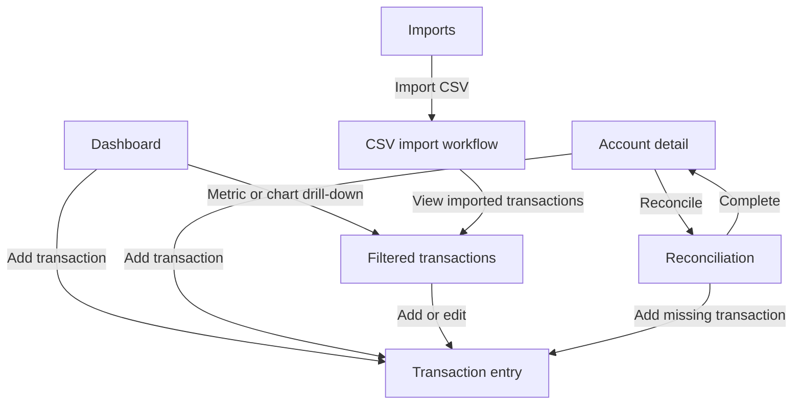

# Financial Services — Product Wireframes

| Field | Value |
|---|---|
| Status | Proposed for product-owner acceptance |
| Version | 0.1 |
| Last updated | 2026-08-18 |
| Applies to | MVP responsive web application |
| Currency | Philippine peso (`PHP`, `₱`) |
| Accepted by | Pending |

These low-fidelity wireframes define information hierarchy, navigation, interaction behavior, responsive adaptation, and required states for the four core workflows. They intentionally do not select branding, a component library, chart library, or final visual style.

Accepted financial behavior in [FINANCIAL_SEMANTICS.md](FINANCIAL_SEMANTICS.md) governs every amount, status, validation rule, and metric shown here.

## 1. Deliverables

| Workflow | Specification |
|---|---|
| Transaction entry | [wireframes/01_TRANSACTION_ENTRY.md](wireframes/01_TRANSACTION_ENTRY.md) |
| CSV import and preview | [wireframes/02_CSV_IMPORT.md](wireframes/02_CSV_IMPORT.md) |
| Account reconciliation | [wireframes/03_RECONCILIATION.md](wireframes/03_RECONCILIATION.md) |
| Dashboard | [wireframes/04_DASHBOARD.md](wireframes/04_DASHBOARD.md) |

Each workflow includes desktop and mobile layouts, state behavior, validation, accessibility expectations, and acceptance scenarios. Tablet layouts use the desktop information hierarchy but collapse secondary columns and actions as space requires.

## 2. Product shell

### 2.1 Desktop shell

```text
┌─────────────────────────────────────────────────────────────────────────────┐
│ Financial Services             Workspace: Personal       Help   User menu  │
├──────────────────┬──────────────────────────────────────────────────────────┤
│ Dashboard        │ Page title                           Primary action      │
│ Accounts         ├──────────────────────────────────────────────────────────┤
│ Transactions     │                                                          │
│ Imports          │ Page content                                             │
│ Budgets          │                                                          │
│ Recurring        │                                                          │
│ Goals            │                                                          │
│ Reports          │                                                          │
│                  │                                                          │
│ Settings         │                                                          │
└──────────────────┴──────────────────────────────────────────────────────────┘
```

Rules:

- The current destination is identified by text and active styling, never color alone.
- Page-level primary actions appear in the page header, such as **Add transaction** or **Import CSV**.
- Workspace switching remains visible but compact. MVP begins with one personal workspace.
- Financial context controls belong to their page, not the global header.
- The interface never exposes raw debit/credit signs unless an explicitly technical audit view is added later.

### 2.2 Mobile shell

```text
┌──────────────────────────────┐
│ Financial Services      Menu│
├──────────────────────────────┤
│ Page title                   │
│ [Primary action]             │
├──────────────────────────────┤
│                              │
│ Page content                 │
│                              │
├──────────────────────────────┤
│ Dashboard Accounts Activity │
└──────────────────────────────┘
```

Rules:

- Bottom navigation contains only Dashboard, Accounts, and Activity. Activity opens Transactions with access to Imports.
- Less frequent destinations remain in the menu.
- A workflow in progress replaces bottom navigation with a compact header, **Back**, and an explicit exit warning when data would be lost.
- Primary completion actions may remain sticky at the bottom when the form or review list is long.

## 3. Navigation and entry points



The browser back action and in-product **Back** return to the previous step without discarding valid input. Any action that would discard work requires confirmation.

## 4. Shared interaction conventions

### 4.1 Amounts and signs

- Amounts display as Philippine pesos using `₱` and two decimal places.
- Users enter positive magnitudes. The selected transaction type and account determine the accepted ledger signs.
- Negative values appear only when they are meaningful results, such as a credit-card credit, refund-driven negative category spending, or negative budget availability.
- Totals use tabular alignment and never rely on color to indicate positive or negative.

### 4.2 Dates and status

- `Transaction date` is the user-facing economic date used by reports and budgets.
- `Posted date` is shown only where settlement or reconciliation requires it.
- Status labels are **Pending**, **Posted**, and **Void**.
- Reconciliation is shown on an account-side entry as **Reconciled**, not as transaction status.

### 4.3 Actions

- Each page or step has one visually dominant action.
- Destructive or history-changing actions state their consequence: **Void transaction**, **Reverse import**, or **Undo reconciliation**.
- Posted corrections explain that the original remains in audit history and a replacement is created.
- Long-running actions disable repeat submission and show progress without implying completion early.

### 4.4 Feedback states

Every workflow specifies:

| State | Required behavior |
|---|---|
| Loading | Preserve page structure and announce progress non-modally |
| Empty | Explain why no data appears and offer the next valid action |
| Validation error | Associate a concise message with the field or row and summarize errors at the top |
| Recoverable system error | Preserve user input and offer retry |
| Conflict/stale data | Explain what changed and reload authoritative data before retrying |
| Success | Confirm the durable result and provide the next relevant destination |

## 5. Responsive model

| Width | Expected adaptation |
|---|---|
| 320–767 px | One column, card-like records instead of wide tables, sticky completion action where helpful |
| 768–1023 px | Collapsed navigation, two-column forms only where labels and values remain readable |
| 1024 px and above | Persistent side navigation, full review tables, summary and detail regions side by side |

No supported layout may require horizontal page scrolling. A data table may use a contained horizontal scroll only when converting it to cards would hide relationships needed for comparison.

## 6. Accessibility baseline

- Every input has a visible label, instructions, error association, and logical keyboard order.
- Native buttons, links, inputs, selects, checkboxes, radios, and tables are used for their intended semantics.
- Focus remains visible and moves to the first error or new step heading after a submitted action.
- Dialogs trap focus, identify their title and consequence, and return focus to the triggering control.
- Status uses text plus icon/shape where visual reinforcement is useful.
- Charts have equivalent tables and descriptive accessible names.
- Tables preserve headers when scrolling; mobile cards include the field label with each value.
- Touch targets and spacing support one-handed mobile use.
- Motion is unnecessary for understanding and respects reduced-motion preferences.

## 7. Content and privacy rules

- Wireframe examples use invented Philippine-peso data and contain no real financial information.
- Full account numbers, credentials, provider tokens, file contents, and raw import payloads never appear in logs or error details.
- Accounts display name and optional last four digits only.
- Confirmation screens show enough information to verify an action without reproducing an entire sensitive source file.

## 8. Product-owner acceptance checklist

- [ ] Shared desktop and mobile application shells are understandable.
- [ ] Navigation supports all four workflows without dead ends.
- [ ] Transaction entry covers expense, income, transfer, split, refund, adjustment, pending, posted, correction, and void behavior.
- [ ] CSV import covers upload, mapping, validation, exact/probable duplicates, confirmation, completion, and reversal.
- [ ] Reconciliation exposes the difference, never auto-adjusts, and reconciles account entries independently.
- [ ] Dashboard totals disclose period, `PHP`, inclusion rules, and drill-down behavior.
- [ ] Loading, empty, error, warning, confirmation, and success states are specified.
- [ ] Desktop and mobile layouts retain the same financial meaning.
- [ ] Keyboard, screen-reader, and non-color accessibility requirements are explicit.
- [ ] No V2/V3 or excluded capability has entered the MVP wireframes.

After product-owner acceptance, change this document and each workflow status to **Accepted**, record the approver/date, and mark the Milestone 0 wireframe task complete in [ROADMAP.md](ROADMAP.md).
